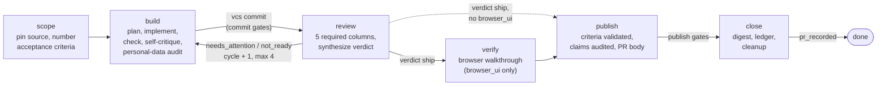

# harness

[](https://github.com/jakewanders/ai-coding-harness/actions/workflows/ci.yml) <!-- harness-lint: allow -->
[](LICENSE)

`harness` is a coding-agent plugin that keeps a unit of work (a ticket, a PR, a file, plain
text) honest as it moves from scope through build, review, verify, publish and close. It is
a stdio MCP server plus stage skills and safety hooks. The server keeps the records, writes
the prose for the PR and handoffs, and refuses stage transitions until the required
evidence exists. It never contacts external systems.

## Contents

- [Why](#why)
- [Stage flow](#stage-flow)
- [Worked example](#worked-example)
- [Glossary](#glossary)
- [Install](#install)
- [Quick start](#quick-start-zero-config)
- [Tools](#tools)
- [Seats](#seats)
- [Modes](#modes)
- [Kits](#kits)
- [Hooks](#hooks)
- [Configuration](#configuration)
- [Why `dist/` is committed](#why-dist-is-committed)
- [Documentation](#documentation)
- [License](#license)

## Why

A coding agent given a ticket and a shell will usually produce a diff. What it does not
reliably produce is the surrounding discipline, because that depends on the model
remembering to be careful:

- The requirement drifts. Ten steps later nobody can say which acceptance criterion a
  given hunk was for, or whether every criterion has proof.
- "Tests pass" is claimed without a recorded run, or from a run on an earlier version of
  the code.
- Review findings are acknowledged in chat and then forgotten, or re-litigated on every
  pass.
- Personal data in log lines, bypass flags (`--no-verify`) and pushes to protected
  branches get through because nothing stands in the way.
- A resumed session, or a second agent, has no durable record of what was decided and why.

`harness` moves those parts out of the prompt and into deterministic code:

- **Bookkeeping.** Requirement text, numbered acceptance criteria, plan, command runs,
  review findings and the PR are written to a local, git-initialized record store, so any
  later stage or session reads the same facts.
- **Gates.** Each stage transition is checked against recorded evidence. `vcs commit`
  refuses until a green check run, a self-critique and a personal-data audit exist for the
  current cycle. Leaving review needs a `ship` verdict; leaving publish needs every
  criterion proven and the PR claims audited. Every refusal names the exact call that
  fixes it.
- **Ghostwriting.** The server returns the finished text of the brief, PR body and handoff
  notes. The agent posts them with its own tools.
- **No external access.** The engine holds no tokens and makes no network calls. Trackers,
  code hosts and chat are reached only through tools the agent session already has.

## Stage flow

Six core stages. `verify` runs only when the repo declares the `browser_ui` capability.



Gates, by the point where they bite (ids are the real gate ids from `src/gates/`):

| Point | Gate | Blocks when |
|---|---|---|
| `vcs commit` in build | `check_command_green` | the latest check (or test) run in this cycle did not exit 0 |
| | `self_critique_recorded` | no `self_critique` evidence this cycle (an empty findings list is valid) |
| | `pii_audit_clean` | no `pii` audit this cycle, or it has findings and no waiver |
| | `defect_repro_before_fix` | the unit is a bug and has no `defect_repro` with red output (or waiver) |
| Leaving review | `review_verdict_ship` | the cycle's synthesized verdict is not `ship` |
| | `ledger_reverified` | warns only: open ledger entries not rechecked |
| Leaving publish, and push or PR creation | `criteria_validated` | any acceptance criterion is missing or `unproven` |
| | `claims_audited` | no `claims` evidence this cycle |
| | `walkthrough_done` | only with `browser_ui`: some criterion is not `pass` in `browser_findings` |
| Finishing close | `pr_recorded` | no `pullreq record` on the unit |

Ten gates in total. Severity is `block`, `warn` or `off`; config can soften a gate and run
modes can demote it, but a demotion is always listed in the PR body.

The review loop: a review that synthesizes anything other than `ship` routes the unit back
to build, and the cycle counter increments when the next build starts. Evidence is scoped
per cycle, so a fix has to be re-checked and re-critiqued. After four cycles without a
`ship`, `unit route` reports `blocked` and asks a human.

Seven standalone flows sit outside this state machine: `pilot` (the conductor that
dispatches one fresh subagent per stage), `convoy` (batch several units), `screen`
(ticket triage), `inspect` (read-only PR review), `respond` (address review comments in
one batched commit per round), `aftercare` (triage follow-up comments on a shipped unit),
and `setup` (first-run configuration).

## Worked example

This is a captured run, not an illustration. It drove the shipped `dist/` tools against a
throwaway git repo in a temp directory, with `HARNESS_VAULT`, `HARNESS_CONFIG` and
`HARNESS_HOME` pointed at temp directories and no network. The repo contained a
`greet.js` returning `"hello " + name` and a `check` script in `package.json`. Output is
trimmed: each response is shown as its first line plus, where useful, part of its JSON
envelope; temp paths are shortened to `<tmp>`. Nothing is edited or invented.

The unit asks for a one-line change: the greeting should end with `!`.

**1. Scope.** Start the unit, record the requirement, number the criteria, move on.

```text
unit start   { "action": "start", "source": "text", "id": "DEMO-1",
               "text": "Greeting should end with an exclamation mark." }
  -> Started DEMO-1 · scope · cycle 0 · thorough · no branch.

spec criteria { "action": "criteria", "id": "DEMO-1",
                "set": ["greet(\"a\") returns \"hello a!\"", "Existing callers need no change"] }
  -> - AC-1: greet("a") returns "hello a!"
     - AC-2: Existing callers need no change

unit advance { "action": "advance", "id": "DEMO-1", "to": "build" }
  -> DEMO-1: scope -> build.
```

**2. Build, first attempt.** `vcs worktree` creates `<tmp>/demo-DEMO-1` on branch
`DEMO-1-exclamation-in-greeting`. After editing `greet.js`, the commit is refused because
no evidence exists yet. This is the full response, envelope included:

```text
vcs { "action": "commit", "id": "DEMO-1", "message": "DEMO-1: add exclamation" }

Commit refused: build-stage gates are failing.
- check_command_green: run the check command (npm run check) through exec run in this cycle so its result is recorded
- self_critique_recorded: record self_critique with { findings: [{ severity, text, addressed }] } (an empty findings list is valid)
- pii_audit_clean: record pii with { findings: [{ file, line, sink: log|storage|analytics|error_body|other, text }] } (empty findings means clean)

{ "v": 1, "ok": false, "summary": "commit blocked by gates",
  "data": { "id": "DEMO-1", "blocking": [ { "id": "check_command_green", "severity": "block", "status": "fail", "remedy": "..." }, ... ], "warnings": [] },
  "next": [] }
```

The agent does what the remedies say, then retries:

```text
exec { "action": "run", "id": "DEMO-1", "name": "check" }
  -> Run 20261102T202307Z-check-a838 passed (exit 0).
evidence { "action": "record", "id": "DEMO-1", "kind": "self_critique", "payload": { "findings": [] } }
  -> Recorded self_critique for DEMO-1 (cycle 0).
evidence { "action": "record", "id": "DEMO-1", "kind": "pii", "payload": { "findings": [] } }
  -> Recorded pii for DEMO-1 (cycle 0).
vcs { "action": "commit", "id": "DEMO-1", "message": "DEMO-1: add exclamation" }
  -> Committed 7312f7e on DEMO-1-exclamation-in-greeting: DEMO-1: add exclamation. Unit moved to review.
```

**3. Review finds a problem.** Five columns are required (`criteria_forward`,
`criteria_reverse`, `adversarial`, `diffaudit`, `ledger`). The reverse pass (does every
hunk trace to a criterion, and is it tested) records one major finding, and the verdict
follows from the columns:

```text
evidence { "action": "record", "id": "DEMO-1", "kind": "review_column",
           "payload": { "column": "criteria_reverse",
                        "findings": [ { "severity": "major", "text": "No test covers greet.js", "path": "greet.js" } ] } }
evidence { "action": "synthesize", "id": "DEMO-1" }
  -> Cycle 0: needs_attention (blocker 0, major 1, minor 0, note 0).
unit { "action": "report", "id": "DEMO-1", "stage": "review", "outcome": "done",
       "summary": "one major finding: no test", "verdict": "needs_attention" }
unit { "action": "route", "id": "DEMO-1" }
  -> retry: build (verdict needs_attention).
```

**4. Build again, cycle 1.** The agent adds `greet.test.js`, then re-runs the check and
re-records the self-critique and audit, because evidence is per cycle:

```text
vcs { "action": "commit", "id": "DEMO-1", "message": "DEMO-1: cover greet with a test" }
  -> Committed 17724af on DEMO-1-exclamation-in-greeting: DEMO-1: cover greet with a test. Unit moved to review.
     (envelope data: "stage": "review", "cycle": 1)
```

**5. Review passes, then publish gates.** All five columns recorded empty this time:

```text
evidence { "action": "synthesize", "id": "DEMO-1" }
  -> Cycle 1: ship (blocker 0, major 0, minor 0, note 0).
unit { "action": "route", "id": "DEMO-1" }       (after unit report with verdict ship)
  -> proceed: publish (verdict ship).

unit { "action": "advance", "id": "DEMO-1", "to": "close" }
  -> Cannot leave publish: 2 blocking gate(s).
     - criteria_validated: record criteria_validation with { results: [{ criterion: AC-n, status: proven|unproven|not_applicable, proof }] }
     - claims_audited: record claims with { claims: [{ text, status: verified|unverified|false, evidence }] }; analyze claims extracts them from the PR body
```

The demo repo has no `browser_ui` capability, so `verify` was skipped and
`walkthrough_done` reported `n/a`. After recording `criteria_validation` (both criteria
`proven`), `claims`, and the PR with `pullreq record`, `evidence gates` shows:

```text
Gates for publish (DEMO-1, cycle 1):
- walkthrough_done [block] n/a
- criteria_validated [block] pass
- claims_audited [block] pass
```

In a real session the agent would call `pullreq body` for the ghostwritten PR text, open
the PR with its own code-host tools, and `unit advance` to close. The example stops at the
point where the gates pass; the PR url used there was a placeholder.

## Glossary

| Term | Meaning |
|---|---|
| **unit** | One piece of work tracked end to end, keyed by an id (a ticket key such as `ABC-123`, a name you choose, or a generated `local-xxxxxxxx` for untracked text). Its state, requirement, plan, run logs, evidence and reviews live in the record store under `<repo namespace>/units/<id>`. |
| **stage** | One step of a unit's lifecycle: scope, build, review, verify, publish, close. The unit has exactly one current stage. |
| **cycle** | A counter starting at 0 that increments each time review sends the unit back to build. Evidence is recorded per cycle. |
| **brief** | The server-rendered instructions a stage skill requests first (`unit brief`). It opens with a versioned YAML header (`harness-brief/1`, see [docs/brief-contract.md](docs/brief-contract.md)), then the seat wiring, config problems, the requirement and the exact tool calls with the unit id filled in. |
| **seat** | A capability role the engine consults, such as `tracker`, `codehost`, `docs`, `design`, `chat` or `reviewbot`. Each seat lists the session tools that fill it. An unwired seat means "skip the steps that need it and say so". `system seats` proposes wiring from your session's tool names. |
| **gate** | A check over recorded evidence that must pass before a transition, commit or push. Gates have a severity (`block`, `warn`, `off`) and return a concrete remedy when they fail. |
| **evidence** | A typed record attached to a unit and cycle, validated against a schema. Nine kinds: `self_critique`, `defect_repro`, `screen_verdict`, `pii`, `criteria_validation`, `claims`, `waiver`, `browser_findings`, `review_column`. |
| **column** | One independent review pass recorded as `review_column` evidence. Six column names exist (`criteria_forward`, `criteria_reverse`, `adversarial`, `diffaudit`, `ledger`, `browser`); the first five are required, `browser` is added when `browser_ui` is declared. `evidence synthesize` merges them into one verdict: `ship`, `needs_attention` or `not_ready`. |
| **ledger** | A per-repo list of standing asks and past landings that outlive a single unit. Review rechecks open entries against each new diff so deferred work is not forgotten. |
| **kit** | A directory with a `kit.yaml` that adds opinions without code: a config fragment, convention docs selected by repo tags or capabilities, and diff-audit rules. See [Kits](#kits). |
| **convoy** | A batch flow for several units: scope each, group them by predicted file overlap, get the grouping approved, then run the groups one after another. Units in a group are linked as siblings with `unit link`. |
| **mode** | A named run preset: `thorough` (everything) or `sketch` (scope and build only). See [Modes](#modes). |
| **waiver** | A `waiver` evidence record with a written rationale that satisfies one named gate. The rationale travels into the PR. |

## Install

Add this repository as a plugin marketplace, then install the `harness` plugin. The plugin
manifest lives in `.claude-plugin/plugin.json`; it declares the skills, the hooks in
`hooks/hooks.json`, and the MCP server entry `dist/server.js`. The build output in `dist/`
is committed, so a fresh clone works without a build step.

To work on the plugin itself (Node 22 or newer):

```sh
npm install && npm run build && npm test
```

## Quick start (zero config)

1. Open a repository and run the `setup` skill once. It runs `system doctor`, maps your
   session's tools onto seats, asks about bots, kits and environments, and writes
   `.harness.yaml` only after you confirm. With no config at all the engine still works:
   commands are inferred from the manifest and lockfile.
2. Start a unit from a ticket, a PR, a url, a file, or plain text with `unit start`, then
   run the `pilot` skill. Pilot dispatches one fresh subagent per stage, routes with
   `unit route`, and stops for you when a stage is blocked.
3. Every stage skill opens with `unit brief`, which renders the header contract
   ([docs/brief-contract.md](docs/brief-contract.md)), the seat wiring, the requirement,
   the plan and the exact tool calls with the unit id filled in.

## Tools

Twelve noun-grouped tools, each taking an `action`:

| Tool | Purpose |
|---|---|
| `unit` | start, status, list, brief, advance, report, route, answer, link |
| `spec` | requirement text, pinned source, numbered criteria, related items |
| `analyze` | impact radius, personal-data audit, claims, coverage reach, criteria map |
| `evidence` | record evidence, list it, resolve gates, synthesize a review verdict |
| `diffaudit` | run kit and config rules over added lines |
| `exec` | run profile or ad-hoc commands with logs kept on disk |
| `vcs` | fetch, diff, branch, worktree, status, gated commit, cleanup |
| `pullreq` | ghostwrite the PR body, record the PR, track review threads |
| `ledger` | add, list, recheck and close carry-forward entries |
| `digest` | write the unit summary, history, wrap-up |
| `recall` | keyword search over past units |
| `system` | version, health, kits, doctor, config, infer, seats |

Every response ends with a versioned JSON envelope (`v`, `ok`, `summary`, `data`, `next`).
The full action inventory is generated from the registry into
[docs/tools.md](docs/tools.md) by `npm run gen:tools`.

## Seats

Capability roles the engine consults: `tracker`, `codehost`, `docs`, `design`, `chat`,
and `reviewbot`. Each seat lists the tool names that fill it, for example a tracker seat
holding `mcp__tracker__get_issue`; an unwired seat means "skip the steps that need it and
say so". Stage briefs show the seats that stage consults. `system seats` proposes the
wiring from your session's tool names, and the `setup` skill writes it to config after you
confirm.

## Modes

`thorough` runs everything. `sketch` runs one subagent from scope through build, skips
review and verify, and opens the PR body with a banner stating nothing reviewed the diff.
Custom modes extend these in config; every demotion is listed in the PR body under a
"Not proven" section.

## Kits

A kit is a directory with `kit.yaml` (a config fragment plus `docs` and `rules`) found on
`HARNESS_KIT_PATHS`, `~/.harness/kits`, the plugin cache, or a sibling kits checkout.
Docs are selected by repo tags and capabilities into the brief header; rules run as the
`diffaudit` review column. [examples/kits/web-ui](examples/kits/web-ui) is the shipped
example.

## Hooks

`hooks/guard.mjs` binds to the host's Bash and Stop events. It blocks verification bypass
flags, pushes to protected branches, staged credentials and oversized files, commits that
fail the unit's build gates, and pushes or PR creation that fail the publish gates; it
warns on personal data heading to a sink and prints the unit status on stop. The unit is
found from the current branch name; with no match the hooks stay silent. On an unbuilt
checkout it blocks `git commit`, `git push` and PR creation with build instructions and
lets everything else pass with a warning.

## Configuration

Layers, rising precedence: built-in defaults, kit fragments, `~/.harness/config.yaml`
(or `HARNESS_CONFIG`), then `.harness.yaml` at the git root. Mappings merge, lists and
scalars replace. A broken layer is skipped and reported in every brief and in `system
doctor`. The record store defaults to `~/.harness/vault`; `HARNESS_VAULT` overrides it and
`HARNESS_HOME` replaces the home directory (the test suite sets both to temp dirs). The
schema is section 5 of the
[design spec](docs/superpowers/specs/2026-09-04-harness-design.md) with the 0.2.0 delta in
the [lean-harness spec](docs/superpowers/specs/2026-09-04-lean-harness.md);
`system config` shows the merged result with provenance, proposes a repo file, and writes
it on request.

## Why `dist/` is committed

A plugin install is a clone, and the MCP server entry is `dist/server.js`. Committing the
compiled output means an install needs no build step and no dev dependencies, and the
safety hooks work immediately. The risk of a committed build is that it goes stale
relative to `src/`. Two checks prevent that:

- `npm run check:dist` compiles `src/` into a temp directory and compares every file with
  `dist/`. It exits non-zero and lists each file that is missing, stale or extra.
- CI (the workflow in `.github/workflows/ci.yml`) <!-- harness-lint: allow -->
  runs on every push to `main` and every pull request, on
  Ubuntu and macOS: typecheck, tests, build, `npm run check:dist`, then
  `git diff --exit-code -- dist`, plus `npm audit` on runtime dependencies. A change to
  `src/` without a rebuilt `dist/` fails the build.

After editing `src/`, run `npm run build` and commit the result with the source change.

## Documentation

- [docs/README.md](docs/README.md) is the index.
- [docs/blueprint.md](docs/blueprint.md): the behavior-level blueprint the harness was
  built from.
- [docs/brief-contract.md](docs/brief-contract.md): the `harness-brief/1` header.
- [docs/tools.md](docs/tools.md): generated tool and action reference.
- [docs/superpowers/specs/](docs/superpowers/specs/): the design spec and the lean-pass delta.
- [docs/history/](docs/history/README.md): planning and prompt artifacts from the
  autonomous build, kept for provenance only.
- [CHANGELOG.md](CHANGELOG.md)

## License

[MIT](LICENSE).
