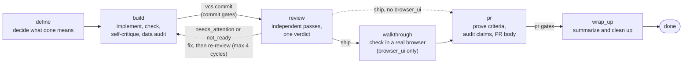

# harness

[](https://github.com/jakewanders/ai-coding-harness/actions/workflows/ci.yml) <!-- harness-lint: allow -->
[](LICENSE)

`harness` makes an AI coding agent prove its work before it can commit or open a pull
request. It keeps the paperwork in code, so the agent cannot skip it by forgetting. It
enforces three things:

- **A commit needs evidence.** The tests ran green, the agent critiqued its own change, and
  it checked the added lines for personal data.
- **A pull request needs proof.** Every acceptance criterion is proven and every claim in
  the PR text is audited. Review must also end in a `ship` verdict first.
- **Dangerous shortcuts are blocked.** No `--no-verify`, no push to a protected branch, no
  staged credentials.

Status: a Claude Code plugin, version 0.2.0, a personal project. It makes no network calls
and holds no tokens. It reaches trackers, code hosts and chat only through tools your
session already has.

## Contents

- [Install](#install)
- [Quick start](#quick-start)
- [How it works](#how-it-works)
- [Worked example](#worked-example)
- [Glossary](#glossary)
- [Reference](#reference)
- [Documentation](#documentation)
- [License](#license)

## Install

In Claude Code:

```text
/plugin marketplace add jakewanders/ai-coding-harness
/plugin install harness@ai-coding-harness
```

The marketplace is named `ai-coding-harness` (`.claude-plugin/marketplace.json`) and the
plugin is named `harness` (`.claude-plugin/plugin.json`). The compiled `dist/` is committed,
so an install needs no build step.

To work on the plugin itself (Node 22 or newer):

```sh
npm ci
npm run build
npm test
```

`npm run typecheck` and `npm run check:dist` are the other two checks CI runs.

## Quick start

1. In a repository, run the `setup` skill once (`/harness:setup`). It checks the install,
   maps your session's tools onto roles, asks about review bots, kits and environments, and
   writes `.harness.yaml` only after you confirm. With no config the engine still works:
   commands are inferred from the manifest and lockfile.
2. Start a unit of work (a ticket, a PR, a url, a file or plain text) and run the
   `conductor` skill. It dispatches one fresh subagent per stage, asks the engine where to go
   next, and stops to ask you when a stage is blocked.
3. Each stage skill opens by requesting its brief (the engine's instructions for that stage,
   with the unit id filled in). You do not call the tools by hand.

## How it works

`harness` is a stdio MCP server (the tools), a set of stage skills (the instructions) and
safety hooks. The server keeps a local, git-initialized record of each unit of work,
writes the text for the brief, PR body and handoff notes, and refuses to move a unit
forward until the evidence for the current stage exists. The agent posts the text with its
own tools.

A coding agent given a ticket will usually produce a diff. What it does not reliably
produce is the discipline around it: acceptance criteria that stay pinned, a recorded test
run for the current code, review findings that are not forgotten, and a record a second
session can read. `harness` moves those parts out of the prompt and into deterministic code.

### Stages

Six stages, in order:

- **define**: decide what "done" means (pin the source, number the acceptance criteria).
- **build**: plan, implement, run the checks, critique the change, audit for personal data.
- **review**: independent review passes merged into one verdict.
- **walkthrough**: check it in a real browser. Only for repos that declare `browser_ui`.
- **pr**: prove each criterion, audit the claims, write the PR body.
- **wrap_up**: summarize, update the ledger and clean up.



Two details the diagram compresses. A successful `vcs commit` is what moves a unit from
build to review. Evidence is scoped to a cycle, and the cycle counter goes up each time the
unit re-enters review after a fix, so a fix has to be re-checked and re-critiqued. After four
cycles without `ship`, `unit route` reports `blocked` and asks a human.

### Review verdicts

Review is a set of independent passes, called columns. Five are required (`criteria_forward`,
`criteria_reverse`, `adversarial`, `diffaudit`, `ledger`), and `browser` is added when the
repo declares `browser_ui`. Each finding has a severity: `blocker`, `major`, `minor` or
`note`. `evidence synthesize` merges the latest record of each column into one verdict
(`src/review/synthesize.ts`):

| Verdict | When | What happens |
|---|---|---|
| `ship` | All required columns are recorded, with no `blocker` and no `major`. `minor` and `note` findings do not change it. | The unit may leave review. |
| `needs_attention` | All required columns are recorded, there is no `blocker`, and at least one `major`. | Back to build: fix, then review again. |
| `not_ready` | Any `blocker` finding, or any required column is missing. | Back to build, the same route as `needs_attention`, but it means the review is incomplete or found something that must not merge. |

Both non-ship verdicts send the unit back to build while fewer than four cycles have run;
only `ship` passes the `review_verdict_ship` gate.

Seven standalone flows sit outside this state machine. `conductor` drives a unit through
every stage. `batch` runs several units as a group. `screen` triages a ticket. `inspect` is
a read-only PR review. `respond` addresses review comments in one batched commit per round.
`aftercare` triages follow-up comments on a shipped unit. `setup` does first-run configuration.

## Worked example

A real capture, not an illustration: the shipped `dist/` tools driven against a throwaway
git repo, with `HARNESS_VAULT`, `HARNESS_CONFIG` and `HARNESS_HOME` pointed at temp
directories and no network. Output is trimmed, and temp paths are shortened to `<tmp>`.
Nothing is invented. The unit adds a greeting function; its criteria are `AC-1: Greets by
name` and `AC-2: Rejects an empty name`.

The agent has defined the unit, created the branch, edited `greet.js`, run the check and
the personal-data audit. It tries to commit with no self-critique recorded. The commit tool
and the hook on `git commit` both refuse, and name the exact call that fixes it:

```text
vcs { "action": "commit", "id": "SMK-1", "message": "feat: greeting" }

Commit refused: build-stage gates are failing.
- self_critique_recorded: record self_critique with { findings: [{ severity, text, addressed }] } (an empty findings list is valid)
```

The hook form of the same refusal (exit code 2, shown on stderr), and a bypass attempt:

```text
git commit -m "greeting"
BLOCKED by harness: commit_gate: build gates failing for SMK-1:
- self_critique_recorded [block] fail — record self_critique with { findings: [...] } ...

git commit --no-verify -m "x"
BLOCKED by harness: no_bypass_flags: verification bypass flags (--no-verify, --no-gpg-sign) are not allowed on git commit
```

The agent does what the remedy says, and the same commit is accepted:

```text
evidence { "action": "record", "id": "SMK-1", "kind": "self_critique", "payload": { "findings": [] } }
  -> Recorded self_critique for SMK-1 (cycle 0).
vcs { "action": "commit", "id": "SMK-1", "message": "feat: greeting" }
  -> Committed d4d7a07 on SMK-1-greeting: feat: greeting. Unit moved to review.
```

<details>
<summary>The rest of the run: review finds a problem, a fix, the PR gates</summary>

**Define** (before the commit above):

```text
unit start { "action": "start", "source": "ticket", "ref": "SMK-1", "text": "Add a greeting that says hello by name." }
  -> Started SMK-1 · define · cycle 0 · thorough · no branch.
spec criteria { "action": "criteria", "id": "SMK-1", "set": ["Greets by name", "Rejects an empty name"] }
  -> - AC-1: Greets by name
     - AC-2: Rejects an empty name
unit advance { "action": "advance", "id": "SMK-1" }
  -> SMK-1: define -> build.
```

**Review, cycle 0.** Five columns are recorded. The `adversarial` column records one major
finding (`"empty name is not rejected"`), so the verdict is `needs_attention` and the
unit cannot leave review:

```text
evidence { "action": "synthesize", "id": "SMK-1" }
  -> Cycle 0: needs_attention (blocker 0, major 1, minor 0, note 0).
unit { "action": "advance", "id": "SMK-1" }
  -> Cannot leave review: 1 blocking gate(s).
     - review_verdict_ship: review verdict for cycle 0 is needs_attention; fix the findings in build and re-review, then evidence synthesize
unit { "action": "advance", "id": "SMK-1", "to": "build" }
  -> SMK-1: review -> build.
```

**Build again.** The agent fixes `greet.js`, then re-runs the check, the audit and the
self-critique, because evidence is per cycle. The commit moves the unit into review as
cycle 1, and all five columns come back empty:

```text
vcs { "action": "commit", "id": "SMK-1", "message": "fix: reject empty name" }
  -> Committed f35d4d0 on SMK-1-greeting: fix: reject empty name. Unit moved to review.
     (envelope data: "stage": "review", "cycle": 1)
evidence { "action": "synthesize", "id": "SMK-1" }
  -> Cycle 1: ship (blocker 0, major 0, minor 0, note 0).
unit { "action": "advance", "id": "SMK-1" }
  -> SMK-1: review -> pr.
```

**pr gates.** The push hook and `unit advance` both refuse until two records exist:

```text
git push origin HEAD
BLOCKED by harness: pr_gate: pr gates failing for SMK-1:
- criteria_validated [block] fail — record criteria_validation with { results: [{ criterion: AC-n, status: proven|unproven|not_applicable, proof }] }
- claims_audited [block] fail — record claims with { claims: [{ text, status: verified|unverified|false, evidence }] }; analyze claims extracts them from the PR body
```

After recording `criteria_validation` (both criteria `proven`) and running `pullreq body`
and `analyze claims`, the gates pass. `walkthrough_done` reports `n/a` because the demo repo
has no `browser_ui`, so the walkthrough stage was skipped:

```text
Gates for pr (SMK-1, cycle 1):
- walkthrough_done [block] n/a
- criteria_validated [block] pass
- claims_audited [block] pass
```

`git push origin HEAD` is then allowed (exit 0) and `unit advance` moves the unit to
wrap_up. The PR url recorded with `pullreq record` was the placeholder
`https://example.test/pr/1`; a real session opens the PR with its own code-host tools.

</details>

## Glossary

| Term | Meaning |
|---|---|
| **unit** | One piece of work tracked end to end, keyed by an id (a ticket key such as `ABC-123`, a name you choose, or a generated `local-xxxxxxxx` for untracked text). Its state, requirement, plan, run logs, evidence and reviews live in the record store under `<repo namespace>/units/<id>`. |
| **stage** | One step of a unit's lifecycle: define, build, review, walkthrough, pr or wrap_up. A unit has exactly one current stage. |
| **cycle** | A counter, starting at 0, that goes up each time the unit re-enters review after a fix. Evidence is recorded per cycle. |
| **brief** | The instructions the engine renders for one stage (`unit brief`), which every stage skill requests first. It opens with a versioned YAML header (`harness-brief/1`, see [docs/brief-contract.md](docs/brief-contract.md)), then the role wiring, config problems, the requirement and the exact tool calls with the unit id filled in. |
| **role** | A job the engine needs done by a tool in your session, such as `tracker`, `codehost`, `docs`, `design`, `chat` or `reviewbot`. Each role lists the session tools that fill it. An unwired role means "skip the steps that need it and say so". |
| **gate** | A check over recorded evidence that must pass before a transition, commit or push. Gates have a severity (`block`, `warn`, `off`) and return a concrete remedy when they fail. |
| **evidence** | A typed record attached to a unit and cycle, validated against a schema. Nine kinds: `self_critique`, `defect_repro`, `screen_verdict`, `pii`, `criteria_validation`, `claims`, `waiver`, `browser_findings`, `review_column`. |
| **column** | One independent review pass, recorded as `review_column` evidence. Six names exist; the first five are required and `browser` is added when `browser_ui` is declared. See [Review verdicts](#review-verdicts). |
| **ledger** | A per-repo list of standing asks and past landings that outlive a single unit. Review rechecks open entries against each new diff so deferred work is not forgotten. |
| **kit** | A directory with a `kit.yaml` that adds opinions without code: a config fragment, convention docs selected by repo tags or capabilities, and diff-audit rules. See [Kits](#kits). |
| **batch** | A flow that runs several units together: define each, group them by predicted file overlap, get the grouping approved, then run the groups one after another. Units in a group are linked as siblings with `unit link`. |
| **conductor** | The flow that drives one unit through every stage, dispatching one fresh subagent per stage and asking `unit route` where to go next. It does no stage work itself. |
| **mode** | A named run preset: `thorough` (everything) or `sketch` (define and build only). See [Modes](#modes). |
| **waiver** | A `waiver` evidence record with a written rationale that satisfies one named gate. The rationale travels into the PR. |

## Reference

- [Tools](#tools)
- [Gates](#gates)
- [Roles](#roles)
- [Modes](#modes)
- [Kits](#kits)
- [Hooks](#hooks)
- [Configuration](#configuration)
- [Why `dist/` is committed](#why-dist-is-committed)

### Tools

Twelve noun-grouped tools, each taking an `action`:

| Tool | Purpose |
|---|---|
| `unit` | start, status, list, brief, advance, report, route, answer, link |
| `spec` | requirement text, pinned source, numbered criteria, related items |
| `analyze` | impact radius, personal-data audit, claims, coverage reach, criteria map |
| `evidence` | record evidence, list it, resolve gates, synthesize a review verdict |
| `diffaudit` | run kit and config rules over added lines |
| `exec` | run profile or ad-hoc commands with logs kept on disk |
| `vcs` | fetch, diff, branch, worktree, status, gated commit, cleanup |
| `pullreq` | ghostwrite the PR body, record the PR, track review threads |
| `ledger` | add, list, recheck and close carry-forward entries |
| `digest` | write the unit summary, history, wrap-up |
| `recall` | keyword search over past units |
| `system` | version, health, kits, doctor, config, infer, roles |

Every response ends with a versioned JSON envelope (`v`, `ok`, `summary`, `data`, `next`).
The full action inventory is generated from the registry into
[docs/tools.md](docs/tools.md) by `npm run gen:tools`.

### Gates

Ten gates, by the point where they bite (ids are the real gate ids in `src/gates/`):

| Point | Gate | Blocks when |
|---|---|---|
| `vcs commit` in build | `check_command_green` | the latest check (or test) run in this cycle did not exit 0 |
| | `self_critique_recorded` | no `self_critique` evidence this cycle (an empty findings list is valid) |
| | `pii_audit_clean` | no `pii` audit this cycle, or it has findings and no waiver |
| | `defect_repro_before_fix` | the unit is a bug and has no `defect_repro` with red output (or waiver) |
| Leaving review | `review_verdict_ship` | the cycle's synthesized verdict is not `ship` |
| | `ledger_reverified` | warns only: open ledger entries not rechecked |
| Leaving pr, and push or PR creation | `criteria_validated` | any acceptance criterion is missing or `unproven` |
| | `claims_audited` | no `claims` evidence this cycle |
| | `walkthrough_done` | only with `browser_ui`: some criterion is not `pass` in `browser_findings` |
| Closing wrap_up | `pr_recorded` | no `pullreq record` on the unit (shown by `evidence gates`) |

Severity is `block`, `warn` or `off`. Config can soften a gate and run modes can demote it,
but a demotion is always listed in the PR body.

### Roles

The roles the engine consults are `tracker`, `codehost`, `docs`, `design`, `chat` and
`reviewbot`. Each lists the tool names that fill it, for example a tracker role holding
`mcp__tracker__get_issue`. An unwired role means "skip the steps that need it and say so".
Stage briefs show the roles that stage consults. The `system roles` action proposes the
wiring from your session's tool names, and the `setup` skill writes it to config after you
confirm.

### Modes

`thorough` runs everything. `sketch` runs one subagent from define through build, skips
review and walkthrough, and opens the PR body with a banner stating nothing reviewed the
diff. Custom modes extend these in config; every demotion is listed in the PR body under a
"Not proven" section.

### Kits

A kit is a directory with `kit.yaml` (a config fragment plus `docs` and `rules`) found on
`HARNESS_KIT_PATHS`, `~/.harness/kits`, the plugin cache, or a sibling kits checkout. Docs
are selected by repo tags and capabilities into the brief header; rules run as the
`diffaudit` review column. [examples/kits/web-ui](examples/kits/web-ui) is the shipped
example.

### Hooks

`hooks/guard.mjs` binds to the host's Bash and Stop events. It blocks verification bypass
flags, pushes to protected branches (default `main`, `master`, `release/*`), staged
credentials and oversized files, commits that fail the unit's build gates, and pushes or PR
creation that fail the pr gates. It warns on personal data heading to a sink and prints the
unit status on stop. The unit is found from the current branch name; with no match the hooks
stay silent. On an unbuilt checkout it blocks `git commit`, `git push` and PR creation with
build instructions and lets everything else pass with a warning.

### Configuration

Layers, rising precedence: built-in defaults, kit fragments, `~/.harness/config.yaml` (or
`HARNESS_CONFIG`), then `.harness.yaml` at the git root. Mappings merge; lists and scalars
replace. A broken layer is skipped and reported in every brief and in `system doctor`. The
record store defaults to `~/.harness/vault`; `HARNESS_VAULT` overrides it and `HARNESS_HOME`
replaces the home directory (the test suite sets both to temp dirs). The schema is section 5
of the [design spec](docs/superpowers/specs/2026-09-04-harness-design.md) with the 0.2.0
delta in the [lean-harness spec](docs/superpowers/specs/2026-09-04-lean-harness.md).
`system config` shows the merged result with provenance, proposes a repo file, and writes it
on request.

### Why `dist/` is committed

A plugin install is a clone, and the MCP server entry is `dist/server.js`. Committing the
compiled output means an install needs no build step and no dev dependencies, and the
safety hooks work immediately. The risk is that it goes stale relative to `src/`. Two
checks prevent that:

- `npm run check:dist` compiles `src/` into a temp directory and compares every file with
  `dist/`. It exits non-zero and lists each file that is missing, stale or extra.
- CI (the workflow in `.github/workflows/ci.yml`) <!-- harness-lint: allow -->
  runs on every push to `main` and every pull request, on Ubuntu and macOS: typecheck,
  tests, build, `npm run check:dist`, then `git diff --exit-code -- dist`, plus `npm audit`
  on runtime dependencies. A change to `src/` without a rebuilt `dist/` fails the build.

After editing `src/`, run `npm run build` and commit the result with the source change.

## Documentation

- [docs/README.md](docs/README.md) is the index.
- [docs/blueprint.md](docs/blueprint.md): the behavior-level blueprint the harness was
  built from.
- [docs/brief-contract.md](docs/brief-contract.md): the `harness-brief/1` header.
- [docs/tools.md](docs/tools.md): generated tool and action reference.
- [docs/superpowers/specs/](docs/superpowers/specs/): the design spec and the lean-pass delta.
- [docs/history/](docs/history/README.md): planning and prompt artifacts from the
  autonomous build, kept for provenance only.
- [CHANGELOG.md](CHANGELOG.md)

## License

[MIT](LICENSE).
